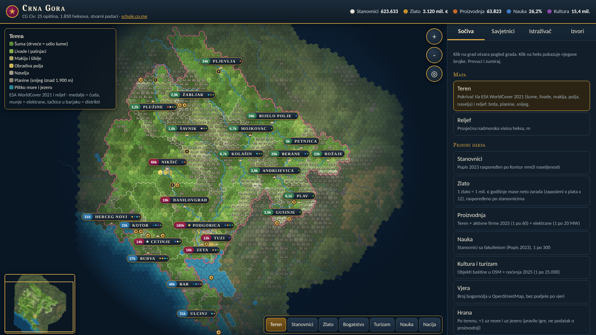
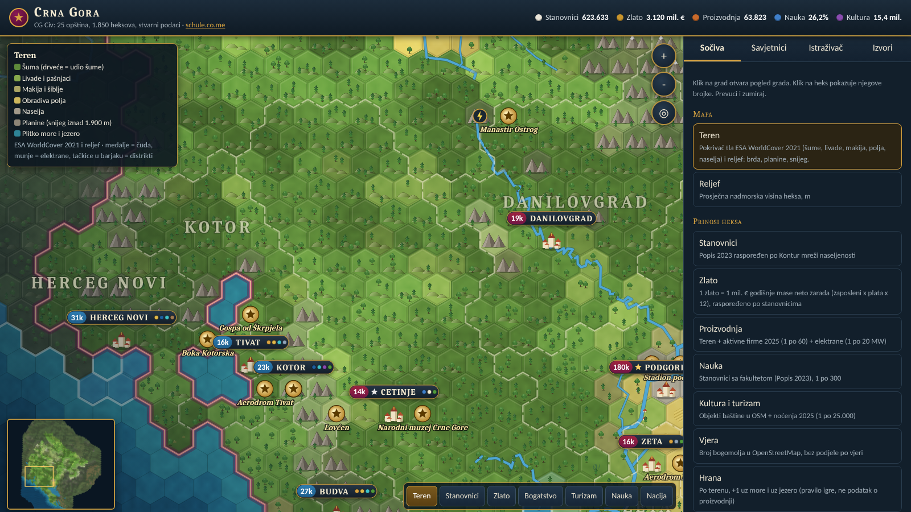
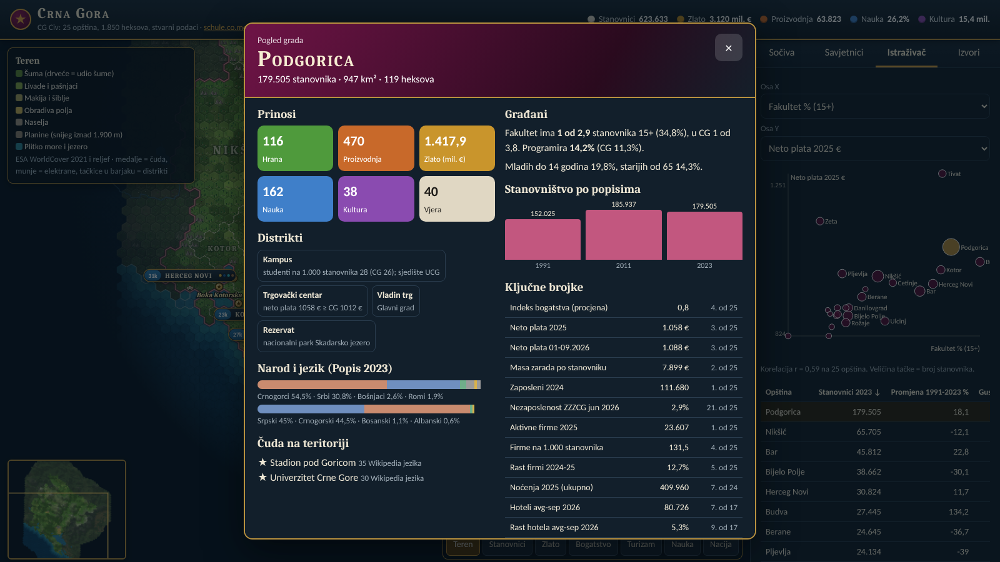
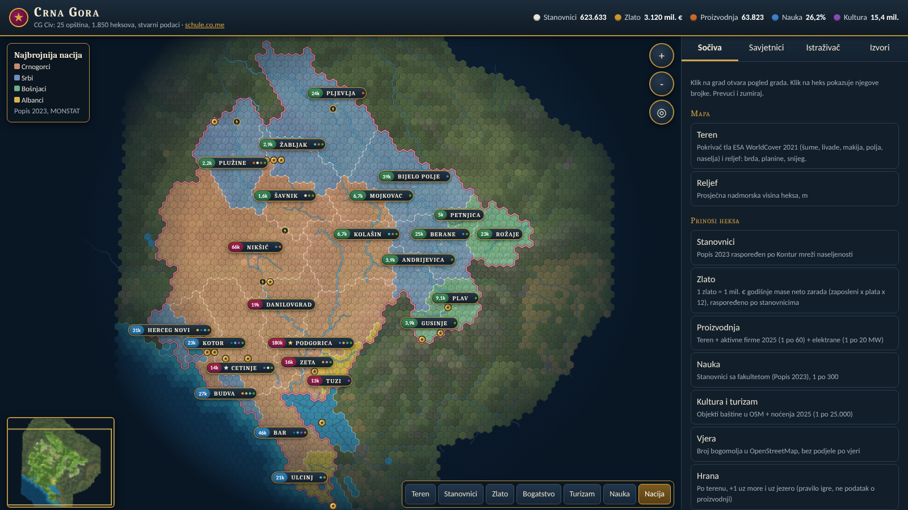
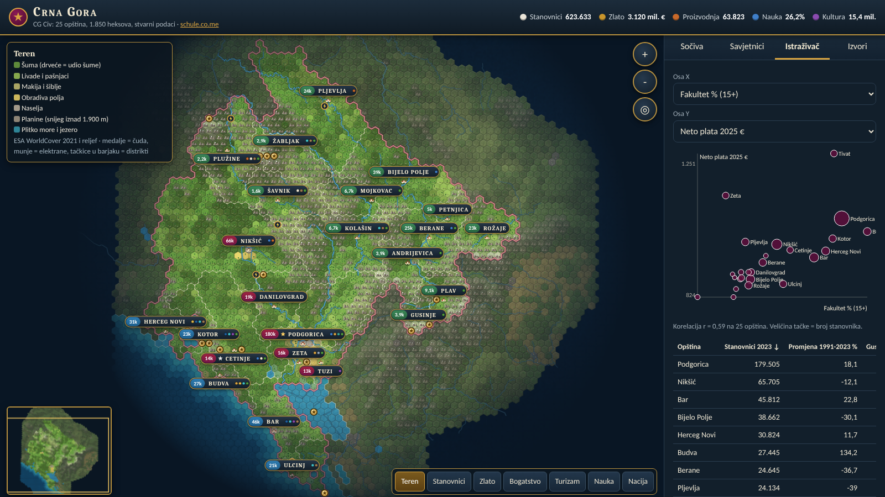

# CG Civ - Crna Gora na heksovima

**Montenegro as a Civilization map.** 25 municipalities on 1,850 hexes, built only from real public data: MONSTAT, Census 2023, the employment agency, OpenStreetMap and Wikidata. Gold is the wage bill, Science is university graduates, Wonders are the most-documented landmarks.

**Mapa uživo / Live map: https://radovansusic.github.io/cg-civ/**

Interaktivna mapa Crne Gore u stilu Civilizacije. Svih 25 opština sa stvarnim podacima, preračunatim na mrežu od 1.850 heksova od po oko 8 km².



| Teren izbliza: Boka, Lovćen, Cetinje | Pogled grada |
|---|---|
|  |  |
| **Najbrojnija nacija (Popis 2023)** | **Istraživač** |
|  |  |

Kratki video (13 s, originalna muzika): [docs/cg-civ-kratki.mp4](docs/cg-civ-kratki.mp4) · trejler (25 s): [docs/cg-civ-trailer.mp4](docs/cg-civ-trailer.mp4)

Po uzoru na Karpathyjev [USA Civ](https://karpathy.ai/usaciv/). Napravio [Schule](https://schule.co.me), Podgorica · [schule.co.me](https://schule.co.me) · office@schule.co.me

## Šta ima

- **Mapa:** teren iz satelitskog pokrivača tla (ESA WorldCover 2021: šume, livade, makija, polja, naselja) i reljefa (brda, planine, snijeg, sjenčenje), rijeke iz OSM-a, Jadran i susjedne zemlje u magli, gradski barjaci sa distriktima, 20 čuda, elektrane, pregledna mapa i brza sočiva.
- **46 sočiva:** 10 prinosa po heksu (zlato, proizvodnja, nauka, kultura, vjera, hrana, stanovnici, noćenja, reljef, teren), 4 sočiva bogatstva (indeks bogatstva, masa zarada po stanovniku, plata januar-septembar 2026, rast plate), 14 pokazatelja po opštini i 18 sočiva iz Popisa 2023 (najbrojnija nacija, najčešći jezik, udjeli nacija, jezika i vjera).
- **Pogled grada** za 25 opština: prinosi, distrikti po objavljenim pravilima, građani, popisi 1991-2011-2023, rang među opštinama.
- **11 savjetnika:** nalazi izračunati iz podataka, uz dugme koje pali odgovarajuće sočivo.
- **Istraživač:** bilo koja dva pokazatelja kao dijagram rasipanja sa korelacijom, plus tabela svih opština povezana sa mapom.

## Jezik Civilizacije

| Prinos | Šta znači u stvarnosti |
|---|---|
| Zlato | Masa neto zarada: zaposleni 2024 x neto plata 2025 x 12, u mil. €. Nije BDP, jer MONSTAT ne objavljuje BDP po opštinama. |
| Proizvodnja | Teren + aktivne firme 2025 (1 po 60) + elektrane (1 po 20 MW) |
| Nauka | Stanovnici sa fakultetom, Popis 2023 (1 po 300) |
| Kultura | Objekti baštine u OSM + noćenja 2024 (1 po 25.000) |
| Vjera | Broj bogomolja u OSM, bez podjele po vjeri |
| Bogatstvo | CG Civ procjena, nije BDP: prosjek z-vrijednosti mase zarada po stanovniku, firmi na 1.000, sezonskih stanova i udjela sa fakultetom |
| Hrana | Pravilo igre po terenu, +1 uz more i jezero |

Brojke opština raspoređene su po heksovima prema naseljenosti (Kontur). Noćenja su raspoređena prema smještajnim objektima (OSM). Zbir po opštini uvijek je jednak zvaničnom podatku.

## Izvori

- MONSTAT, Statistički godišnjak 2025, pogl. 28 (stanovništvo 1948-2023, demografija 2024, zaposleni 2024, turizam 2024, luke, škole, studenti, zdravstvo, MOP)
- MONSTAT, Popis 2023: pol i starost, obrazovna struktura (37/2025), rad na računaru (168/2024), stanovi (43/2025)
- MONSTAT, Mjesečni statistički pregled 10/2026, str. 29: prosječna neto zarada po opštinama, Ø 2025 i Ø januar-septembar 2026
- MONSTAT, Popis 2023, saopštenje 135/2024: nacionalna pripadnost, vjera, maternji jezik i jezik kojim se govori, po opštinama
- MONSTAT, Broj i struktura poslovnih subjekata u CG (2026): aktivni subjekti 2024 i 2025
- ZZZCG, polugodišnji izvještaj 2026: registrovani nezaposleni i stopa po opštinama, 30.6.2026.
- MONSTAT, Dolasci i noćenja turista ukupno 2025 (saopštenje 27/2026) i mjesečna saopštenja avgust i septembar 2025/2026 (kolektivni smještaj)
- MONSTAT, Procjene stanovništva i osnovni demografski pokazatelji 2025 (saopštenje 59/2026): prirodni priraštaj
- Kontur Boundaries i Kontur Population ME 2023 (CC BY 4.0)
- Terrarium visinske pločice (AWS Open Data / Mapzen)
- ESA WorldCover 2021 v200, 10 m (CC BY 4.0): pokrivač tla po heksu
- © OpenStreetMap saradnici (ODbL): rijeke
- Natural Earth (javno dobro)
- © OpenStreetMap saradnici (ODbL): bogomolje, smještaj, baština
- Wikidata (CC0): elektrane i čuda

Kontrola zbirova: stanovnici 623.633, zaposleni 257.390, nezaposleni 26.833, firme 63.823, studenti 16.005, sa fakultetom 133.931. Sve je jednako zvaničnim ukupnim brojevima.

## Pokretanje

```bash
python3 -m http.server -d site 8000   # zatim otvori http://localhost:8000
# GitHub Pages: korijen repoa preusmjerava na site/; kopija je i u docs/
```

Ponovna izgradnja podataka (izvorni fajlovi idu u `raw/`, koji nije u repou):

```bash
pip install geopandas shapely pyogrio pdfplumber pillow pyproj
python3 scripts/fetch_wikidata.py     # Wikidata tačke
python3 scripts/extract_stats.py      # MONSTAT / ZZZCG PDF -> build/muni_stats.json
python3 scripts/extract_popis2.py     # Popis 2023: nacija, jezik, vjera -> build/popis2.json
python3 scripts/extract_2026.py       # turizam 2025/2026, nezaposleni 6/2026, priraštaj 2025
python3 scripts/build_hex.py          # heks mreža -> build/cgciv.json
python3 scripts/build_visual.py       # pokrivač tla, okolne zemlje, rijeke -> build/cgviz.json (traži rasterio)
cp build/cgciv.json build/cgviz.json site/
```

## Ograničenja

- Pokrivač tla je satelitska klasifikacija iz 2021, uzorkovana sa 61 tačkom po heksu; mali objekti i usjevi mogu biti propušteni.
- Petnjica nema objavljen turizam za 2025; mjesečni hotelski podaci za 8 malih opština se ne objavljuju (povjerljivost).
- Zdravstveni radnici nijesu objavljeni za Gusinje, Petnjicu, Tuzi i Zetu.
- Plate po opštinama očitane su sa slike tabele u biltenu, pa ih treba provjeriti pri svakom ažuriranju.
